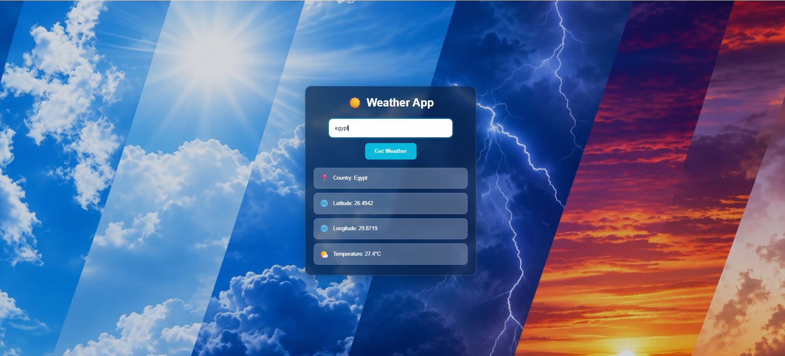

# ☀️ Weather App

A simple and responsive web app that takes a country or city name and shows its coordinates and current temperature.

Built with **Node.js**, **Express**, and **Handlebars**, using the **Mapbox Geocoding API** to find the location and the **WeatherAPI** to get the current weather.

## Screenshots

### Home


### Weather Result


### Error Handling


## Features

- Search by country or city name
- Displays country, latitude, longitude, and current temperature (°C)
- Friendly error messages for invalid locations or API failures
- Loading state on the button while fetching data
- Clean glassmorphism UI with a responsive layout
- API keys stored securely in environment variables

## Tech Stack

- **Backend:** Node.js, Express.js
- **Templating:** Handlebars (hbs)
- **Frontend:** HTML, CSS, Vanilla JavaScript
- **APIs:** [Mapbox Geocoding API](https://docs.mapbox.com/api/search/geocoding/), [WeatherAPI](https://www.weatherapi.com/)

## Getting Started

### Prerequisites

- [Node.js](https://nodejs.org/) installed
- A free API key from [WeatherAPI](https://www.weatherapi.com/)
- A free access token from [Mapbox](https://www.mapbox.com/)

### Installation

1. Clone the repository:

```bash
   git clone https://github.com/reemwebdev365-ai/YOUR-REPO-NAME.git
   cd YOUR-REPO-NAME
```

2. Install dependencies:

```bash
   npm install
```

3. Create a `.env` file in the root folder (you can copy `.env.example`) and add your keys:

```env
   WEATHER_API_KEY=your_weatherapi_key_here
   MAPBOX_TOKEN=your_mapbox_token_here
   PORT=3000
```

4. Start the app:

```bash
   npm start
```

5. Open your browser at [http://localhost:3000](http://localhost:3000)

## How It Works

1. The user enters a country or city name.
2. The server sends the name to the **Mapbox Geocoding API** to get its latitude and longitude.
3. The coordinates are sent to the **WeatherAPI** to get the current temperature.
4. The result is returned to the browser and displayed on the page.

## API Endpoint

```
GET /weather?address=<country or city name>
```

**Example response:**

```json
{
  "country": "Egypt",
  "latitude": 26.4942,
  "longitude": 29.8719,
  "temperature": 27.4
}
```

## Project Structure

```
├── public/
│   ├── css/
│   │   └── style.css
│   ├── images/         # Background images
│   └── js/
│       └── script.js   # Client-side script
├── screenshots/        # README screenshots
├── src/
│   ├── app.js          # Express server
│   └── tools/
│       ├── geocode.js  # Mapbox geocoding
│       └── forecast.js # WeatherAPI request
├── views/
│   └── index.hbs       # Main page
├── .env.example
├── .gitignore
├── package-lock.json
└── package.json
```

## Security Note

API keys are loaded from a `.env` file, which is ignored by Git. Never commit your real keys. Use `.env.example` as a template.

## Author

**Reem**
GitHub: [@reemwebdev365-ai](https://github.com/reemwebdev365-ai)